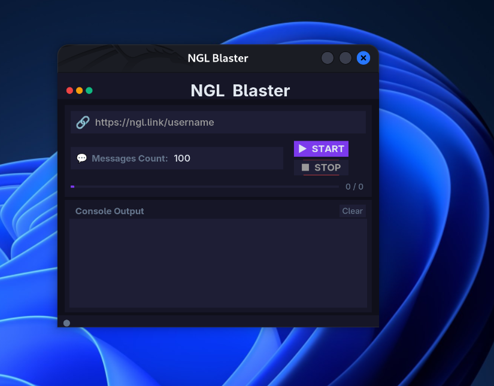

# NGL Blaster 🚀

A fast, multithreaded desktop tool and CLI utility for sending automated anonymous messages to NGL.link targets with ultra-low CPU usage and smart rate-limit backoff.

<p align="center">
  
</p>

## Features

- **Modern Dark GUI**: CustomTkinter-based interface with macOS-styled controls, responsive dark theme, and real-time activity console.
- **Ultra-Low CPU Usage**: Direct lightweight HTTP requests (~0–1% CPU) instead of heavy Chromium instances.
- **Custom Count & Unlimited Mode**: Type any number of messages or toggle continuous sending mode.
- **Smart Cloudflare Cooldown**: Automated synchronized backoff and retry handling across all worker threads.
- **CLI Mode**: Standalone command-line script (`ngl_bot.py`) for headless/server environments.

---

## Installation

1. **Clone the repository**:
   ```bash
   git clone https://github.com/sharendev/ngl-blaster.git
   cd ngl-blaster
   ```

2. **Set up virtual environment (optional but recommended)**:
   ```bash
   python3 -m venv .venv
   source .venv/bin/activate
   ```

3. **Install dependencies**:
   ```bash
   pip install -r requirements.txt
   ```

---

## Usage

### 1. GUI Application
Launch the desktop application:
```bash
python3 ngl_gui.py
```
- Enter your target link: `https://ngl.link/[USERNAME]` (or just `[USERNAME]`).
- Enter the number of messages to send, or toggle **∞ Unlimited Mode**.
- Click **▶ START** to begin or **■ STOP** to pause anytime.

### 2. Command-Line Interface (CLI)
Run directly from terminal:

- Send a specific number of messages:
  ```bash
  python3 ngl_bot.py --url https://ngl.link/TARGET_USER --count 100
  ```

- Send unlimited messages continuously:
  ```bash
  python3 ngl_bot.py --url https://ngl.link/TARGET_USER --unlimited
  ```

---

## Disclaimer
This project is for educational and testing purposes only. Please respect platform terms of service and avoid harassment or abuse.
